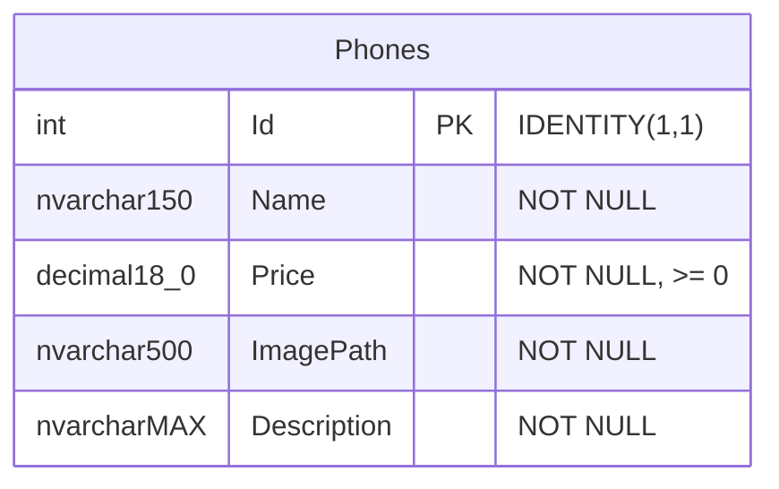

# CSDL điện thoại

Thiết kế Database First theo cách tổ chức bài giảng: tạo CSDL bằng SQL trước, ánh xạ bằng EF Core SQL Server, đăng ký DbContext trong Program và dùng API Controller. AppDbContext được viết tường minh theo schema để dễ đọc; không bắt buộc cài công cụ scaffold để chạy. Không dùng EF migrations hoặc tự xóa/tạo DB khi API khởi động.

Một bảng là đủ cho hai màn hình; không cần bảng hãng hoặc loại sản phẩm khi không có chức năng sử dụng chúng. `ImagePath` là đường dẫn nội bộ `/images/ten-anh.jpg`; API đổi thành `imageUrl` tuyệt đối. Không lưu ảnh dạng nhị phân vào DB.

Chạy `schema.sql` rồi `seed.sql` bằng sqlcmd với biến `DatabaseName`; dùng `scripts/Setup-Database.ps1` để lấy cấu hình cục bộ tự động. Script không xóa DB có sẵn. Seed chỉ thêm id mẫu chưa có, không ghi đè dữ liệu và không tạo bản sao khi chạy lại. Nếu đã tự chỉnh sửa dữ liệu, API sẽ trả dữ liệu đã chỉnh sửa; các mẫu JSON minh họa bộ seed ban đầu.

7 sản phẩm theo tên hiển thị trang 19. Sáu mức giá đầu theo hình; giá Redmi A3 2.500.000 VND là dữ liệu mẫu do phần giá bị cắt trong PDF. Mô tả được viết cho bài thực hành, không phải thông tin bán hàng hiện hành.
